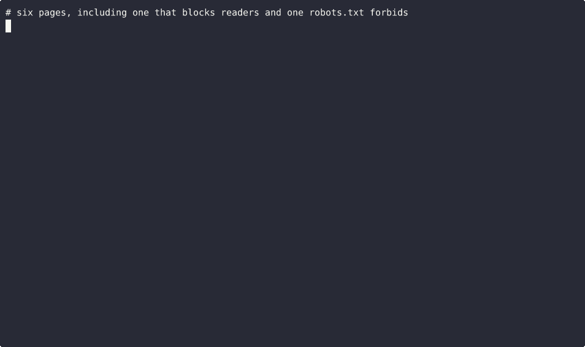

# receipt-scraper



Give it a list of web pages. You get back a spreadsheet of what was on each one, and a saved copy of every page with a fingerprint, so anyone can check later that the data really came from that page.

Most scrapers hand you a CSV and that's it. If a number looks wrong you can't tell where it came from. This one keeps the receipts.

## What you get

`results.csv` has one row per page: the status, where it ended up after redirects, title, description, main heading, word count, and when it was fetched.

`receipts/` has the raw page exactly as the server sent it, plus the readable text.

`manifest.json` has the SHA-256 of every saved page.

Each page gets one of these outcomes, so nothing is left as a quiet blank:

| outcome | meaning |
|---|---|
| ok | read fine |
| thin | almost no text came back. Either the page is short or it's built by JavaScript. Open the receipt to see which |
| blocked | the site refused (403, 429, a "verify you are human" page). Contents are never guessed |
| robots | robots.txt says no, so it wasn't fetched |
| not_html | a PDF or file, saved as is |
| error | 404, timeout, dead host |

## Use it

```
pip install -e .
receipt-scraper run urls.txt --out out
receipt-scraper verify out
```

`urls.txt` is one link per line. Lines starting with # are skipped.

`verify` re-checks every saved page against its fingerprint and fails loudly if anything was changed.

It waits a second between hits to the same site and follows robots.txt by default (`--delay`, `--ignore-robots` to change that).

## Tests

`./check.sh` runs the tests against a local test server that plays every case above (normal page, JS shell, 403, captcha wall, robots block, redirect, PDF, 404, dead host, plain text refusal), then re-verifies the example run.

`examples/out` is a real run on six pages chosen so the saved copies are fine to share: a public domain text, a tiny page, a PDF, a block, a missing page, and one robots.txt turned away.
